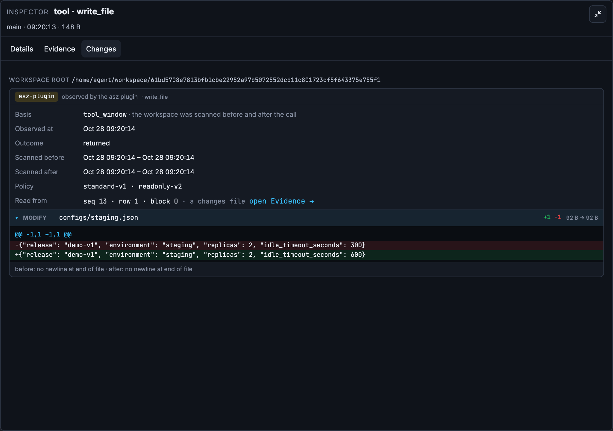

# Collect Cloud Sessions, Evaluate Locally: Analyzing AI Agents on Amazon Bedrock AgentCore with Apache SkyWalking AI Sessionizer

Once an agent runs in the cloud, how do you retain its execution history and evaluate its work using the CLI on your development machine? This tutorial follows four steps with a release assistant that makes real Amazon Bedrock calls: deploy the agent and collector, pull a conversation, configure a local judge, and read the report.

The [previous AgentCore walkthrough](https://builder.aws.com/content/3KjX67DohBgEr8yPadw5MoDSV5C/agentcore-langgraph-agent) introduced conversation and file-change recording with Apache SkyWalking AI Sessionizer (`asz`). Here, remote server, `pull`, and `judge` separate continuous collection from evaluation on demand. The cloud retains the records; the developer starts evaluation locally. The cloud collector needs no evaluator CLI or CLI login session.

## 1. Deploy the agent and asz collector

### What this example deploys

The agent uses LangGraph and `ChatBedrockConverse` inside Amazon Bedrock AgentCore Runtime, calling `us.amazon.nova-pro-v1:0` in `us-east-1` with temperature 0. The model chooses its tool calls. There are no scripted model responses or predetermined judge results.

The business environment is a release simulator. Tools write JSON configuration, validate it, create release bundles, and persist simulated deployments and acceptance requests as state files. Production deployment is denied by a permission rule. These tools do not deploy a real production application. Bedrock inference, AgentCore execution, collection, and local evaluation are real.

```text
LangGraph agent in AgentCore
  ├─ Model calls → Amazon Bedrock
  ├─ Traces → private ALB → asz on ECS Fargate
  └─ File changes → shared EFS → asz
                                  │
                            HTTPS / asz pull
                                  ↓
                         Local conversation snapshot
                           ├─ asz view
                           └─ asz judge → local CLI → CLI's model service
```

The collector runs in a separate Fargate task with 0.5 vCPU and 1 GiB memory, storing records on EFS. Agent traces reach the ingestion port through a private ALB. Local pull requests reach asz through a public NLB, which passes TCP through to TLS termination inside asz. Ingestion and pull use separate tokens, and the pull endpoint permits only the configured client egress IP.

“Local evaluation” describes where the snapshot, evaluator process, and results live. Conversation content read by the CLI still goes to its model service.

### Prepare the environment

Install Git, Go 1.27+, uv, OpenSSL, AWS CLI, OpenTofu, and a running Docker engine. Your AWS identity needs permission to create the example infrastructure and invoke the selected Bedrock model in `us-east-1`. For evaluation, install and sign in to Claude Code or Codex CLI.

The example lives in its own `examples/pull-judge/` directory. The earlier article's agent, configuration, and deployment scripts remain unchanged.

```sh
git clone --branch poc/pull-judge https://github.com/wu-sheng/aws-agentcore-asz-demo.git
cd aws-agentcore-asz-demo/examples/pull-judge
bash scripts/bootstrap.sh
export PATH="$PWD/.work/bin:$PATH"
```

`bootstrap.sh` builds pinned versions of asz and the file recorder, installs Python dependencies, runs business-tool tests, and checks local HTTPS and authenticated pull. This walkthrough used commit `341f8c0c9cb8245669cbe45ff5393f6972e05616`. Bootstrap creates no cloud resources and makes no Bedrock calls.

Check your AWS management credentials. Sign in first if you do not have a valid session:

```sh
aws login
aws sts get-caller-identity
```

The deployed agent accesses Bedrock through its Runtime IAM role. A local Bedrock API token does not need to go into the image or deployment configuration.

### Create the cloud environment

Run these commands from `examples/pull-judge/`. Replace `YOUR_PUBLIC_IPV4` with your actual public egress IPv4 address. If using a proxy, use its egress address.

```sh
.venv/bin/python scripts/prepare-cloud.py --client-ip YOUR_PUBLIC_IPV4

AGENT_IMAGE=ghcr.io/wu-sheng/aws-agentcore-asz-pull-judge-agent:b3e872bfb9a26fbd8bfac6eab6073d241b79c904 \
  bash scripts/up.sh
```

This is the ARM64 image built by GitHub Actions and used in this run. `up.sh` checks AWS identity and model access, copies the image into your account's ECR, and uses OpenTofu to create networking, EFS, the Fargate collector, and the AgentCore Runtime. It writes a resource manifest to `.work/cloud/resources.txt`. AWS resources and model calls incur charges.

`prepare-cloud.py` generates the example TLS certificate and deployment parameters. The infrastructure writes this core remote server configuration for asz, providing the certificate, key, and token files during deployment:

```yaml
remote_server:
  tokens_file: /asz/config/tokens
  tls:
    cert_file: /asz/config/cert.pem
    key_file: /asz/config/key.pem
```

The example certificate is self-signed and valid for seven days. The client verifies it using a CA file and certificate name. For longer use, configure your own certificate and renewal process. See the [official pull documentation](https://skywalking.apache.org/docs/skywalking-ai-sessionizer/next/en/setup/remote-pull/) for remote server configuration.

## 2. Run a conversation and pull it locally

### Give the agent a task that evolves

After deployment, run:

```sh
.venv/bin/python scripts/cloud.py
```

The runner sends the seven requests in `scenarios/release.json` to one AgentCore session. Its session ID also serves as the LangGraph thread ID, preserving context across requests.

| Turn | Work requested | What it lets us inspect |
| --- | --- | --- |
| 1 | Create and validate staging configuration with two replicas and a 300-second timeout; do not deploy | File delivery and validation |
| 2 | Change the timeout to 600 seconds and validate again | Whether delivery follows a revised requirement |
| 3 | Build, deploy to staging, then query and verify | Execution versus confirmation of the result |
| 4 | Build and deploy to production; explain successes and failures | A successful build with a denied deployment |
| 5 | Submit acceptance, confirm approval, and retain the request ID | Successful submission versus unknown approval |
| 6 | Inspect configuration and propose autoscaling; wait for confirmation | Planning versus implementation |
| 7 | Cancel autoscaling, keep two replicas, and summarize | Cancellation and the final summary |

The runner pulls snapshots A, B, and C after turns 1, 5, and 7. It prints a `.work/cloud-TIMESTAMP` directory containing `turn-*.json` responses, `checkpoints.json` with snapshot tags, and the generated local configuration at `client/asz.yaml`. Tool calls and scores can differ on another run because the model chooses its actions.

### Understand the pull configuration

Enter the printed directory's `client/` subdirectory, substituting your timestamp:

```sh
cd .work/cloud-TIMESTAMP/client
```

The generated `asz.yaml` already contains the endpoint, token file, CA file, and storage path. Its essential structure is:

```yaml
storage:
  root: ./data
adapters: []
remotes:
  - name: demo
    url: https://YOUR_NLB_HOST:8788
    token_file: /path/to/demo.token
    ca_file: /path/to/demo-ca.pem
    server_name: asz-pull-judge.internal
```

`demo` is the client's name for the remote service. `token_file` supplies authentication; `ca_file` and `server_name` verify this example's certificate. This snippet explains the structure; keep using the actual generated configuration.

To list, pull, and inspect conversations manually:

```sh
asz pull -list -remote demo
asz pull demo/CONVERSATION_ID
asz view
```

Get `CONVERSATION_ID` from the list and `SNAPSHOT_TAG` from the pull output or `checkpoints.json`. The reference `demo/CONVERSATION_ID:SNAPSHOT_TAG` selects a fixed snapshot. Later interactions do not change it. Pulling the same head again returns `unchanged`.

In `asz view`, open the pulled conversation to inspect requests, model calls, tool results, and file changes. This complete conversation recorded 17 model calls, 21 tool calls, and 11 changes. The following view shows the timeout in `configs/staging.json` changing from 300 to 600 seconds.



## 3. Configure and run the local judge

### Choose an evaluator

Keep the existing `storage`, `remotes`, and other settings in `client/asz.yaml`, and merge the following `judge` section. Do not create two `judge` keys. The generated file uses JSON syntax, which is valid YAML; either edit that JSON or convert the configuration to YAML.

```yaml
judge:
  timeout: 15m
  mode: single
  read_bytes: 524288
  evaluators:
    claude:
      kind: cli
      program: claude
      args: []
      max_turns: 60
    codex:
      kind: cli
      program: codex
      args: []
```

`claude` and `codex` are already built-in evaluator names. Expanding them here makes the settings explicit. Install and authenticate only the CLI you intend to use, and ensure its program is available on your local PATH.

| Setting | How this walkthrough uses it |
| --- | --- |
| `kind: cli` / `program` | asz starts the local CLI, which uses its authenticated model access |
| `timeout: 15m` | Limits one evaluator call, rather than the total report duration |
| `mode: single` | Gives each stage needing evaluation to one evaluator call, which can make multiple model requests |
| `read_bytes: 524288` | Limits navigation response bytes read by one evaluator call to 512 KiB |
| `max_turns: 60` | Bounds Claude CLI turns; adjust alongside time and reading budgets for longer conversations |

This example leaves `model` unset, using the CLI's default. To select a model explicitly, set `model` under the evaluator to an identifier supported by that CLI and available to your account. See the [judge documentation](https://skywalking.apache.org/docs/skywalking-ai-sessionizer/next/en/setup/judge/) for other evaluators and stage-specific plans.

### Evaluate a fixed snapshot and retrieve the result

Run these commands from `client/`, replacing the conversation ID and tag:

```sh
asz judge -evaluator claude \
  -remote-conversation demo/CONVERSATION_ID:SNAPSHOT_TAG

asz judge -list \
  -remote-conversation demo/CONVERSATION_ID:SNAPSHOT_TAG

asz judge -show 1 \
  -remote-conversation demo/CONVERSATION_ID:SNAPSHOT_TAG

asz judge -show 1 -json \
  -remote-conversation demo/CONVERSATION_ID:SNAPSHOT_TAG > judge-C.json
```

The first command creates a judge run. `-list` lists saved runs, `-show 1` reads run 1, and `-json` exports its stage data. If earlier runs already exist, select the intended run number from the list. Viewing and exporting do not invoke the model again.

These commands read an existing local snapshot, so the cloud collector need not be online. To pull the current cloud head before judging, use an untagged reference:

```sh
asz judge -evaluator claude -pull \
  -remote-conversation demo/CONVERSATION_ID
```

To use another evaluator on the same snapshot:

```sh
asz judge -evaluator codex \
  -remote-conversation demo/CONVERSATION_ID:SNAPSHOT_TAG
```

The new result gets its own run; earlier reports remain. Keep the snapshot fixed, then compare how each evaluator defines targets and cites evidence.

## 4. Read the judge report

Read in this order: **stage status, targets and criteria, evidence and delivery history, then scores and cost**. The examples below come from Claude run 1 on snapshot C. Excerpts omit some lines and long evidence text.

### Start with report completeness

The report starts with stage status. This run reported:

```text
ledger       complete  by asz, computed
targets      complete  by claude
achievement  partial  ... 2 criteria or claims without evidence beyond the agent's words were weakened
subtasks     complete  by claude, no call, nothing to answer
efficiency   partial  ... 1 of 8 talks were not labeled
close        partial  by asz, computed
```

`ledger` summarizes recorded usage; `targets` identifies user targets; `achievement` evaluates results; `subtasks` handles delegated work; `efficiency` examines avoidable work; `close` assembles the result. This example has no subtasks, so that stage needed no model call.

Here, `partial` describes incomplete or weakened evaluation output. The accompanying text explains what happened: two judgments relying only on the agent's words were weakened, and the efficiency stage left an item unlabeled. Read these notes even when the command exits successfully. A report marked `partial` is different from a target marked `partly`, which means partial achievement.

### Check that targets match the user's request

`t1` and `t2` identify targets within this run. `t1.c3` identifies a criterion, and `t1.e3` a delivery event. Match the target and criteria to the original request before accepting an outcome label.

The configuration target includes:

```text
t1  A validated staging configuration ... 100/100
    outcome   achieved; standing t1.e3, t1.e4; 2 rounds of rework
    record    achieved: 5 of 5 criteria met, on observed result; closed
    why       t1.c3 met: idle timeout is 600 seconds (changed from the original 300)
                read: The recorded change shows the timeout line going from 300 to 600 and the final validation reads 600.
```

File changes and validation reading 600 support the completed target. `standing` names the deliveries still in effect, while `history` shows the 300-second version being replaced by the 600-second version. The two rounds of rework mean that a score of 100 does not imply success on the first attempt or no wasted effort.

In this run, the agent issued writes and validation in parallel. Validation encountered a missing file or stale value, and the model retried. The user's change from 300 to 600 is a requirement change; repairing incorrect tool ordering is a different kind of work. Rework does not itself lower achievement once the target is met. Its cost belongs in the efficiency analysis.

### Follow evidence to the work and the gaps

| Report section | What to read |
| --- | --- |
| `why` | Which criterion was met and the supporting evidence |
| `claims` | Whether the agent's statements are supported, contradicted, or unconfirmed |
| `history` / `standing` | How delivery evolved and which versions remain in effect |
| `did` | Actual file changes, remote operations, and delivered answers |
| `gap` | Unmet criteria or insufficient evidence |
| `cost` | Calls, tokens, time, and avoidable work for the target |

A `tool/... returned` reference points to a tool result; `msg/...` to an agent reply; `input/...` to a user request; identifiers such as `o3` point to change records. Check the underlying records in `asz view`. The text following `read:` is the evaluator's interpretation. `why, proposed` and `improvement, proposed` offer hypotheses and suggestions that also need to be read against the evidence.

The staging target shows why this matters:

```text
t2  The release bundle is built ... 0/100 (40 by the record)
    outcome   contradicted; standing t2.e1, t2.e2, t2.e3
    record    partly: 2 of 4 criteria met, on observed result; closed
```

`deploy` returned success and wrote simulated deployment state. However, `get_deployment` ran in parallel, read `not_deployed`, and was never retried. The report can list bundle and state-file changes under `did` while also showing that the query did not confirm the final state. It classified the delivered conclusion as `contradicted`, reducing the final score to zero.

This does not establish that deployment never happened. Check “deployment returned success” separately from “a subsequent query verified deployment.” The report itself also needs review: it marks querying after deployment as met while acknowledging that the query ran alongside deployment. Resolve that inconsistency using the recorded tool ordering.

Other outcomes in the same report illustrate additional reading patterns:

| Situation | This run's result | How to interpret it |
| --- | --- | --- |
| Production deployment denied | Target labeled `achieved` | The evaluator wrote the criterion as attempting deployment. The tool returned `denied` and `deployed: false`; the label does not establish deployment success |
| Acceptance submitted with `approved: null` | Target labeled `achieved` | The criterion became reporting approval status. Submission and confirmation of approval remain separate |
| User cancels autoscaling | `cancelled`, unscored | Cancellation is excluded from achievement scoring; the earlier plan can still be reviewed |

This report contained no separate `cannot_verify` target. If another report does, it means the evidence cannot establish the target's result. That differs from `not_achieved`, where unmet criteria have supporting evidence. Individual criteria can also be `unknown` or `not_captured`; read their reasons. An agent answering “unknown” does not guarantee that the evaluator assigns the corresponding target label.

### Read the scores and cost as different measures

The report ends with this actual output:

```text
score
  achievement  83/100 over 5 targets judged: achieved 3, partly 2, not achieved 0; 0 cannot be verified; 1 cancelled or replaced, not scored
  final        75/100 over the targets scored, 83 by the record
  efficiency   79/100: avoidable 21% of the reviewed cost, by tokens; 100% of the targets' cost reviewed
  delivered    66% of the targets' cost went to targets achieved, by tokens

conversation   48.5k tokens
judging        263.8k tokens (3 stages unpriced); the evaluators reported 2.57 USD
```

**`achievement` measures completion by the record.** The five eligible targets scored 100, 40, 100, 100, and 75, averaging 83. The cancelled target is excluded. Staging's 40 comes from two met criteria divided by four criteria plus one contradicted claim: `2 / (4 + 1)`. It is therefore more than a simple percentage of criteria met.

**`final` also considers contradiction or reversion of standing deliveries.** Staging's delivered conclusion was contradicted, making its final score zero. The other four target scores stayed unchanged, giving an average of 75. Use `history`, `standing`, and the cited contradiction to understand this adjustment. The [full rules](https://skywalking.apache.org/docs/skywalking-ai-sessionizer/next/en/concepts-and-designs/conversation-judge/) also distinguish contradiction of an entire delivered conclusion from contradiction of individual criteria.

**`efficiency` measures the share of reviewed cost not classified as avoidable.** Here the unit is tokens: about 21% was classified as avoidable, giving approximately 79. This is neither accuracy nor a 79% speed improvement. The adjacent 100% describes coverage of target cost. Read it alongside the stage's `partial` note; it does not establish that every part of the analysis is complete.

**`delivered` is the share of target cost allocated to achieved targets.** Here that is approximately 66%, a cost distribution rather than another achievement score.

Finally, distinguish two costs. `conversation` is the evaluated agent's model usage; `judging` is the evaluation's own usage. Reading evidence and making repeated model requests can consume more tokens than the original conversation. `unpriced` means pricing information is incomplete, not that execution was free. The reported 2.57 USD comes from the evaluator and is not an AWS invoice.

Turn findings into concrete changes. For this agent, sequence dependent tools as “write → validate → build → deploy → query,” and require the final summary to identify unconfirmed states. Run the revised agent, pull a new snapshot, and judge again, continuing to inspect the criteria and evidence.

## Preserve results and clean up

Snapshots and their judge results have retention limits. Archive the local snapshots, reports, and logs you need, excluding tokens and TLS private keys. Then return to `examples/pull-judge/` and run:

```sh
bash scripts/down.sh --yes
bash scripts/down.sh check
```

AWS-managed AgentCore network interfaces may delay final network cleanup. Follow the `check` output. The example README also covers removal of the experiment's Container Insights log group.

The [isolated example](https://github.com/wu-sheng/aws-agentcore-asz-demo/tree/poc/pull-judge/examples/pull-judge) contains the code, deployment parameters, and scripts. Other snapshots, the Codex comparison, and cloud load measurements are retained in the [experiment record](CLOUD-RESULTS.md).

## References

- [Apache SkyWalking AI Sessionizer documentation](https://skywalking.apache.org/docs/skywalking-ai-sessionizer/next/readme/)
- [asz pull: remote servers, authentication, and snapshots](https://skywalking.apache.org/docs/skywalking-ai-sessionizer/next/en/setup/remote-pull/)
- [asz judge: commands and evaluator configuration](https://skywalking.apache.org/docs/skywalking-ai-sessionizer/next/en/setup/judge/)
- [Conversation Judge: targets, evidence, and scoring](https://skywalking.apache.org/docs/skywalking-ai-sessionizer/next/en/concepts-and-designs/conversation-judge/)
- [AgentCore Runtime versions, endpoints, and sessions](https://docs.aws.amazon.com/bedrock-agentcore/latest/devguide/runtime-how-it-works.html)
