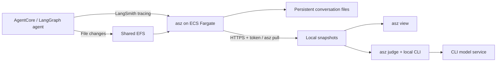

# Collect Cloud Sessions, Evaluate Locally: Analyzing AI Agents on Amazon Bedrock AgentCore with Apache SkyWalking AI Sessionizer

> Review draft, October 28, 2026. Both language versions use the same real AgentCore experiment and a disclosed simulated business environment. See the [experiment record](CLOUD-RESULTS.md) for evidence, disputed judgments and measurement details. Not yet published to AWS Builder.

After an agent says “done,” several questions remain. Did it satisfy the original goal or a narrower interpretation? Did repeated work follow a change in requirements, or did the agent run dependent tools in parallel? Does a submitted request establish that approval has been confirmed?

In the [previous AgentCore walkthrough](https://builder.aws.com/content/3KjX67DohBgEr8yPadw5MoDSV5C/agentcore-langgraph-agent), Apache SkyWalking AI Sessionizer (`asz`) preserved execution records and file changes. This experiment follows those records further: **keep collection in the cloud, pull selected conversations when needed, and evaluate them with a local agent CLI.**

We deployed a LangGraph agent using a real Amazon Bedrock model to Amazon Bedrock AgentCore Runtime, completed seven turns, pulled three snapshots, and ran local judgments. The results show completed work, rework, missing evidence and cancellation. They also show why an evaluator's interpretation of a goal needs review.

## A release assistant that really calls Bedrock

The agent uses `ChatBedrockConverse` with `us.amazon.nova-pro-v1:0` in `us-east-1`, temperature 0 and a maximum output of 2,048 tokens. Missing model configuration is an error; there is no scripted model fallback. The model chooses its tools and subsequent actions.

The business system is simulated. Tools actually read and write JSON files, validate a schema, build bundles containing the configuration, and persist simulated deployments and acceptance requests. A permission rule denies production deployment. The acceptance lookup tool is configured to be unavailable. These tools do not operate a real production application.

The available tools are `read_file`, `write_file`, `validate_config`, `build_release`, `deploy`, `get_deployment`, `submit_acceptance` and `get_acceptance`. Each conversation has a separate workspace. The AgentCore session ID also identifies its LangGraph thread. The recorder watches tools that modify files and records changes across their invocation windows.

On AgentCore, Bedrock access uses the runtime's IAM role. A Bedrock API token was used during local preparation, but it was not placed in the image or runtime configuration.

The cloud collector, local CLI, LangChain instrumentation and file recorder are pinned to `341f8c0c9cb8245669cbe45ff5393f6972e05616`, including the latest #94 update used in this experiment. The example records dependencies and image build details.

## Cloud collection, local evaluation on demand



The collector runs as a separate ECS Fargate task with 0.5 vCPU and 1,024 MiB of memory, storing files on EFS. We selected a five-second collection interval so the demonstration could show results soon after each interaction.

Tracing reaches port 1985 through a private ALB. Remote pull uses a separate token. An NLB forwards TCP to native TLS in asz, with ingress restricted to the client's outbound IP. The experiment uses a self-signed certificate, verified locally through `ca_file` and `server_name`. An incorrect token returned HTTP 401. The NLB uses TCP health checks so an authentication-protected page's 401 response is not treated as a service failure.

The cloud collector does not install an evaluator CLI or maintain its login session. Evaluation starts only when the developer explicitly runs `asz judge`. “Local” describes the process, snapshots and results: the conversation content an evaluator reads still goes to its model service.

## Seven turns with evidence to inspect

| Turn | User request | Observed behavior |
| --- | --- | --- |
| 1 | Prepare and validate staging with two replicas and a 300-second timeout; do not deploy | Validation ran before the write finished; a retry passed |
| 2 | Change the timeout to 600 seconds and validate again | The first validation read the old value; the model retried and validation then read 600 |
| 3 | Build, deploy to staging, then query and verify | Deploy returned success, but a parallel query read `not_deployed`; the model did not query again |
| 4 | Build and deploy production; report successes and failures | After recovering from initial validation/build failures, it built a valid bundle; deployment was denied |
| 5 | Submit acceptance, confirm approval and retain the ID | Submission succeeded with `approved: null`; the model reported unknown without calling the lookup tool |
| 6 | Inspect configuration and propose autoscaling; wait for confirmation | It proposed a plan without another inspection call or file modification |
| 7 | Cancel autoscaling, retain two replicas and summarize | No further tool calls or file changes; it returned a summary |

This run did not call `get_acceptance`. We therefore cannot claim that it observed the unavailable acceptance service. Unavailability was a fixture condition; the actual record establishes that the submission response contained no approval decision.


The screenshot comes from the pulled cloud conversation: `configs/staging.json` changed from 300 to 600 seconds. Tool results also show that the first parallel validation read the old configuration, while a later retry read the new value. The final answer alone would hide that sequence.

The full conversation contains seven user turns, 17 model calls, 21 tool calls and 11 change records. The view reports `verified`, with no unresolved items. Change-record count is not a count of distinct files.

## Pull a fixed version of the conversation

Configure a named remote locally. This is a configuration template: use your deployment output and credential paths, and keep tokens out of articles and repositories.

```yaml
storage:
  root: ./data
adapters: []
remotes:
  - name: demo
    url: https://YOUR_NLB_HOST:8788
    token_file: ./secrets/demo.token
    ca_file: ./secrets/demo-ca.pem
    server_name: asz-pull-judge.internal
```

`server_name` matches the experiment's certificate. A certificate trusted by the system and matching the URL hostname can use the corresponding simpler configuration.

```sh
asz pull -list -remote demo
asz pull demo/CONVERSATION_ID
asz view
```

Take the conversation ID from the remote listing. We pulled after turns 1, 5 and 7. Each tag fixes the records at that point; later interactions do not modify an existing snapshot.

| Snapshot | Turns | Model calls | Tag | Single pull duration |
| --- | ---: | ---: | --- | ---: |
| A | 1 | 3 | `20261028T012012.181192000Z` | 7.70 s |
| B | 5 | 15 | `20261028T012311.930162000Z` | 11.52 s |
| C | 7 | 17 | `20261028T012355.350667000Z` | 10.12 s |

Pulling C again returned `unchanged` and took 10.46 seconds. Reusing data does not guarantee a shorter end-to-end request: these calls crossed a regional proxy connection, with only one sample of each operation. A read-only status check after turn 5 also encountered a TLS interruption. We retained the five successful responses, resumed collection and pull, then executed turns 6 and 7 without replaying earlier agent operations.

## Judge the snapshots locally

We first used an installed and authenticated Claude Code CLI:

```sh
asz judge -evaluator claude \
  -remote-conversation demo/CONVERSATION_ID:SNAPSHOT_TAG

asz judge -show 1 \
  -remote-conversation demo/CONVERSATION_ID:SNAPSHOT_TAG
```

Add `-pull` only when the command should fetch the current cloud head first. To test independence from the collector, we copied the configuration and changed its remote URL to `https://127.0.0.1:9`. A real `pull -list` failed with connection refused, while judging existing snapshots without `-pull` continued. We subsequently stopped the agent session and began cloud cleanup; the local evidence remained available.

The evaluator identifies targets and criteria, navigates a read-only conversation interface, and cites tool results and file changes. asz aggregates recorded usage and configured prices. A, B and C were judged separately; this is not an automatic trend comparison.

| Snapshot / Claude run 1 | Report state | Record score | Final score | Efficiency |
| --- | --- | ---: | ---: | ---: |
| A | partial | 100 | 100 | 71 |
| B | complete | 81 | 75 | 73 |
| C | partial | 83 | 75 | 79 |

The [judge summary](assets/judge-summary.json) preserves the stage states, criteria and scores. Read these values alongside the target definitions and evidence. They are not standalone quality conclusions. C has one cancelled target excluded from achievement scoring. The agent recorded 46,694 input and 1,840 output tokens. These calls were unpriced in the current asz configuration, which does not mean their cost was zero. The three Claude reports together reported approximately USD 5.86; this is CLI-reported cost, not an actual payment statement.

## What the reports reveal—and what needs review

**Achievement and rework can coexist.** A's configuration target was `achieved`, with a recovery after failed validation. C retains the user's change from 300 to 600 seconds as well as execution mistakes. A requirement change should not automatically count as avoidable agent work.

**Successful deployment and completed verification are separate criteria.** Staging's deploy returned success, but a concurrent query read the old `not_deployed` state. Without another query, the requested verification was incomplete. Claude classified that target as `contradicted` and assigned a final score of zero. A human reviewer must still retain the successful deploy result; the score does not establish that deployment never happened.

**An evaluator may narrow the goal.** Production returned `denied` and `deployed: false`. However, Claude wrote a criterion as “a production deployment is attempted.” Attempting deployment and reporting failure then satisfied it, so the target appeared `achieved`. That is a reason to inspect the interpretation of the user's request, not evidence that production was deployed.

**Unknown status does not disappear behind an achievement label.** The acceptance request was saved, but its approval field was null. Claude interpreted the criterion as reporting approval status and also returned `achieved`. It did not create a separate `cannot_verify` target. We should neither invent that label for the demonstration nor translate `achieved` into “acceptance approved.”

**Cancellation is different from failure.** C's autoscaling target was `cancelled` and excluded from scoring. The proposed plan still needs review: it did not inspect the configuration again, and its new fields exceeded the existing schema. Cancellation does not validate the earlier plan.

**A partial report is different from a partly achieved target.** A discarded one observation during citation, excerpt or duplicate checks. C weakened two judgments lacking evidence beyond the agent's own words, and its efficiency stage also left one item unlabeled. `partial` describes the evaluation artifact; `partly` describes a target's achievement. They are not interchangeable.

We then ran `asz judge -evaluator codex` against the same C snapshot, retaining it as run 2. It classified staging verification and approval confirmation as `partly`, but production still used an “attempt deployment” criterion.

| Target in C | Claude run 1 | Codex run 2 | Evidence a reviewer must retain |
| --- | --- | --- | --- |
| Staging deployment and verification | contradicted, 0 | partly, 67 | Deploy returned success; query verification remained incomplete |
| Production | achieved, 100 | achieved, 100 | Deployment was denied; both criteria required an attempt |
| Acceptance | achieved, 100 | partly, 67 | Submission succeeded; approval remained unknown |
| Autoscaling | cancelled, unscored | cancelled, unscored | No implementation; the plan still needs review |

The Codex report was also `partial`, with a final score of 80 and efficiency of 94. One main target could not be established, and one judgment lacking independent evidence was weakened. Its record did not report a model name or cost; we did not infer them. One comparison cannot establish which CLI is generally better. It does demonstrate the value of preserving the same snapshot and inspecting criteria and citations.

## What work stayed on the cloud service?

We queried the same ECS service's CloudWatch metrics with a 60-second period. CPU percentage is relative to its allocated 0.5 vCPU; memory percentage is relative to 1,024 MiB. Averages below are means of the per-minute Average values; maxima are the largest CloudWatch Maximum values in each window.

| Phase (UTC) | Minute samples | CPU average / maximum | Memory average / maximum |
| --- | ---: | ---: | ---: |
| Idle before the conversation, 01:18–01:19 | 1 | 4.10% / 4.19% | 4.49% / 4.49% |
| Window containing interaction and pulls, 01:19–01:25 | 6 | 9.35% / 24.16% | 5.20% / 5.47% |
| During local judging, 01:25–01:31 | 6 | 4.33% / 4.54% | 5.29% / 5.37% |

The supported conclusion is narrow: this small conversation was collected and pulled on the stated allocation, and cloud CPU during local judging was close to the earlier idle sample. Collection polling, EFS and health checks still did work. This is not zero overhead, and one-minute aggregation cannot isolate each short pull peak or establish production throughput.

Network metrics were retained as service-level Bytes/Second, not interpreted as bytes transferred by an individual pull. Collection and pull overlapped in some minutes, and the idle baseline contains only one sample. These are reproducible PoC observations, not a capacity benchmark. See [ECS service metrics](https://docs.aws.amazon.com/AmazonECS/latest/developerguide/service_utilization.html) and [Container Insights metrics](https://docs.aws.amazon.com/AmazonCloudWatch/latest/monitoring/Container-Insights-metrics-ECS.html).

## Reproduce the experiment and retain its evidence

The [isolated example](https://github.com/wu-sheng/aws-agentcore-asz-demo/tree/poc/pull-judge/examples/pull-judge) lives under `examples/pull-judge/`, with the agent, seven requests, separate OpenTofu configuration, cloud/pull/judge runners and teardown script. Its ARM64 image is built by a dedicated GitHub Actions workflow under a separate package name and commit tag. The previous article's code, commands and pinned versions are unchanged.

After preparing dependencies and AWS authentication as described in the example README:

```sh
.venv/bin/python scripts/prepare-cloud.py --client-ip YOUR_PUBLIC_IPV4
AGENT_IMAGE=YOUR_WORKFLOW_IMAGE bash scripts/up.sh
.venv/bin/python scripts/cloud.py
.venv/bin/python scripts/judge.py .work/cloud-TIMESTAMP
bash scripts/down.sh --yes
bash scripts/down.sh check
```

For a proxied client, allow the actual proxy egress IP. Archive snapshots, judgments, tool evidence and required logs before deleting cloud EFS. Snapshots and their judgments have retention limits; keep a separate evidence archive that excludes tokens and TLS private keys.

We stopped the agent session and verified removal of the AgentCore runtime, Fargate tasks, EFS, NAT gateway, Elastic IP, load balancers and experiment log groups. AWS-managed AgentCore network interfaces still hold the private subnets and security group, so final VPC cleanup is waiting for their release. These remaining network resources have no independent usage charge. The experiment record retains the cleanup status and evidence locations.

## References

- [Apache SkyWalking AI Sessionizer documentation](https://skywalking.apache.org/docs/skywalking-ai-sessionizer/next/readme/)
- [asz pull documentation](https://skywalking.apache.org/docs/skywalking-ai-sessionizer/next/en/setup/remote-pull/)
- [asz judge documentation](https://skywalking.apache.org/docs/skywalking-ai-sessionizer/next/en/setup/judge/)
- [Judgment, evidence scope and cost model](https://skywalking.apache.org/docs/skywalking-ai-sessionizer/next/en/concepts-and-designs/conversation-judge/)
- [AgentCore runtime versions, endpoints and sessions](https://docs.aws.amazon.com/bedrock-agentcore/latest/devguide/runtime-how-it-works.html)
