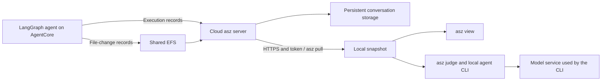

# Collect Cloud Sessions, Evaluate Locally: Analyzing AI Agents on Amazon Bedrock AgentCore with Apache SkyWalking AI Sessionizer

> Editorial status: English draft, October 28, 2026. A real Nova Pro seven-turn conversation, local collection, HTTPS pull and local Claude Code judge have been exercised; see the [local experiment record](LOCAL-RESULTS.md). AgentCore deployment and cloud load measurements are still pending. The cloud procedure below remains unverified. Replace all evidence placeholders before publication; both languages use the same evidence.

When an agent says a task is complete, what supports that conclusion? A successful tool call might mean that an application was submitted, not approved. Writing a configuration file does not establish that the configuration is valid. Other tasks reach the right outcome after repeated changes, which may reflect an agent mistake or a change in the user's requirements.

In the [previous AgentCore walkthrough](https://builder.aws.com/content/3KjX67DohBgEr8yPadw5MoDSV5C/agentcore-langgraph-agent), Apache SkyWalking AI Sessionizer, whose command is `asz`, preserved execution records and file changes. This article follows those records into another workflow: pulling a selected cloud conversation onto a developer's computer and evaluating its outcomes, cost, and rework with a local agent CLI.

## A simulated release environment with a real Bedrock model

The proposed example runs a LangGraph release assistant on Amazon Bedrock AgentCore Runtime. A real Amazon Bedrock model selects tools, reads their results, and decides what to do next.

The business environment is simulated. A validation tool reads a configuration file the agent actually wrote. A deployment tool stores a version and configuration digest in an environment state file. A status tool reads that saved state. The production environment denies deployment permission, and an external acceptance result is temporarily unavailable. These are disclosed experimental conditions.

This makes success, failure, and missing evidence observable without prescribing the agent's responses or the judge's conclusions.

[EVIDENCE NEEDED: AWS Region, agent model ID, agent and asz commits, image digests, dependency versions, and experiment date.]

## Cloud collection and local evaluation

The agent sends execution records to a cloud asz service through LangChain's tracing client. File-change records reach asz through a shared directory. The service assembles and stores conversations and serves requests from local pull clients.



Evaluation runs on demand. Collection does not automatically start a judge run, and the cloud collector does not need the evaluator CLI or its login state. Once pulled, a snapshot can be evaluated more than once locally.

Local evaluation means that the evaluation process, snapshot, and results reside on the developer's computer. The CLI still sends the conversation content it reads to the model service it uses.

[EVIDENCE NEEDED: Final deployment diagram, HTTPS termination, token provisioning, local connectivity, and ALB health-check configuration.]

## One release across several turns

All requests use the same AgentCore session ID, which also identifies the LangGraph thread.

| Stage | User request | Experimental condition |
| --- | --- | --- |
| Prepare | Generate and validate a staging configuration with two replicas and a 300-second idle timeout | File creation and validation are available |
| Revise | Change the timeout to 600 seconds and validate again | Preserve both revisions |
| Deploy | Deploy staging and query its state to verify the configuration | The simulated deployment persists readable state |
| Promote | Build a production release bundle and deploy it | Bundle creation succeeds; deployment permission is denied |
| Accept | Submit staging for acceptance and confirm approval | Submission returns a saved request ID; result lookup is unavailable |
| Plan | Add an autoscaling objective, but require a plan and confirmation before implementation | Implementation is not yet authorized |
| Close | Cancel autoscaling implementation and summarize the existing results | Cancellation must be distinguished from failure |

These conditions do not guarantee a fixed target decomposition. Building a bundle and deploying it may become one partly completed target or separate successful and unsuccessful targets. We will examine whether the conclusions match the evidence.

[EVIDENCE NEEDED: Actual conversation excerpts and observed agent behavior. This table is an experimental plan, not a transcript.]

## Pull a specific version of the conversation

Configure a remote named `demo` on the developer's computer. The address below is a placeholder; the deployment procedure must supply the token file.

```yaml
storage:
  root: ./data
remotes:
  - name: demo
    url: https://asz.example.internal:8788
    token_file: ./secrets/demo.token
```

For a private certificate authority, also configure `ca_file`. Configure the ingestion credential separately from the pull token.

Run these commands from the configuration directory:

```sh
asz pull -list -remote demo
asz pull demo/CONVERSATION_ID
asz view
```

Replace `CONVERSATION_ID` with the identifier shown by the listing. Preserve the snapshot tag printed by pull. Later activity in the cloud does not modify that snapshot.

The experiment will pull after configuration preparation, after acceptance submission, and after cancellation. These are three snapshots of one growing conversation.

[EVIDENCE NEEDED: Actual listing and pull output, local replay, and file-change screenshots.]

## Evaluate with a local CLI

For example, with Claude Code installed and signed in, evaluate a fixed snapshot:

```sh
asz judge -evaluator claude -remote-conversation demo/CONVERSATION_ID:SNAPSHOT_TAG
asz judge -list -remote-conversation demo/CONVERSATION_ID:SNAPSHOT_TAG
asz judge -show RUN_NUMBER -remote-conversation demo/CONVERSATION_ID:SNAPSHOT_TAG
```

Replace the placeholders with the actual conversation ID, snapshot tag, and run number. To pull the latest version before evaluating it:

```sh
asz judge -pull -evaluator claude -remote-conversation demo/CONVERSATION_ID
```

The evaluator reads evidence through read-only conversation navigation. The model identifies targets, judges achievement, and labels work. asz computes and allocates costs from recorded model usage and configured prices. Missing usage and missing prices remain unknown or unpriced.

## Five distinctions to read in the report

### Achievement supported by evidence

The staging deployment should be supported by its configuration, validation result, deployment response, and state verification. An `achieved` result should lead back to those records through its citations.

[EVIDENCE NEEDED: Actual target, rationale, citations, and report excerpt.]

### Achievement with rework

Changing the timeout from 300 to 600 seconds requires another edit and validation. The judge can retain that rework and identify a changed requirement as its cause. Rework is not a final outcome class and does not automatically lower the achievement score; its cost and efficiency are separate considerations.

If the model makes an actual mistake that validation catches, that provides another rework example. A user's requirement change should not automatically count as avoidable agent work.

[EVIDENCE NEEDED: Actual rework, cause, cost, and final outcome.]

### Failure and partial completion

A generated production bundle and a denied deployment are separate facts. The report should retain the completed work without describing the rejected deployment as successful.

[EVIDENCE NEEDED: Actual target grouping and `not_achieved`, `partly`, or other reported outcomes.]

### An outcome that cannot be verified

An acceptance request ID establishes submission, not approval. When the lookup supplies no result, approval remains unknown. The report may separate submission from approval or distinguish met and unknown criteria within one target.

[EVIDENCE NEEDED: Unknown criteria and whether `cannot_verify` appears. Explain the actual report if it does not; never substitute an invented output.]

### A target the user cancelled

Cancelled autoscaling implementation should be distinguished from failed implementation. A delivered plan and cancelled implementation may also be separate targets. Cancelled targets are not scored.

[EVIDENCE NEEDED: Cancellation evidence, target status, and scoring treatment.]

## How much work remains on the cloud collector?

The first pull requires the server to prepare and transfer data. A repeated pull can reuse local files but still contacts the server. Evaluating an existing snapshot without `-pull` does not require access to remote asz.

The experiment will record cloud CPU, memory, storage, and network activity during collection, the first pull, a repeated pull, and local judging. A second local judge run will restrict access to remote asz while retaining connectivity to the evaluator's model service.

[EVIDENCE NEEDED: Deployment size, conversation size, measurement method, sample count, and results. A small PoC does not establish production-scale capacity.]

## Reproduce the example

The new example is planned under `examples/pull-judge/`, with separate images, configuration, and deployment state. The previous article's example, commands, and pinned versions remain intact.

[BEFORE PUBLICATION: Add the pinned example commit, deployment and cleanup commands, measured charges, and model-access prerequisites.]

Local snapshots and their judge runs expire. Archive the complete experiment separately when the article's evidence must be retained long term. Use the documentation for the tested version for retention defaults and configuration.

## References

- [Original example repository](https://github.com/wu-sheng/aws-agentcore-asz-demo)
- [Pull guide at the writing reference commit](https://github.com/apache/skywalking-ai-sessionizer/blob/341f8c0c9cb8245669cbe45ff5393f6972e05616/docs/en/setup/remote-pull.md)
- [Judge guide at the writing reference commit](https://github.com/apache/skywalking-ai-sessionizer/blob/341f8c0c9cb8245669cbe45ff5393f6972e05616/docs/en/setup/judge.md)
- [Judge outcomes and cost model](https://github.com/apache/skywalking-ai-sessionizer/blob/341f8c0c9cb8245669cbe45ff5393f6972e05616/docs/en/concepts-and-designs/conversation-judge.md)
- [AgentCore VPC connectivity](https://docs.aws.amazon.com/bedrock-agentcore/latest/devguide/agentcore-vpc.html)
