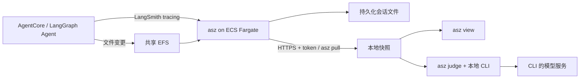

# 采集云端会话，本地评估：用 Apache SkyWalking AI Sessionizer 分析 Amazon Bedrock AgentCore 上的 AI Agent

Agent 回答“已经完成”之后，我们还需要回答几个问题：它完成的是用户原来的目标，还是一个缩小了范围的目标？重试是因为用户改变了要求，还是因为 Agent 把有先后依赖的工具并行调用了？申请提交成功，是否就等于批准结果已经得到确认？

在[上一篇 AgentCore 实践](https://builder.aws.com/content/3KjX67DohBgEr8yPadw5MoDSV5C/agentcore-langgraph-agent)中，我们用 Apache SkyWalking AI Sessionizer（`asz`）保存执行过程和文件变更。这次继续往后走一步：**云端保留采集服务，开发者按需拉取会话，再使用本地 Agent CLI 进行评估。**

我们实际运行了一个使用 Amazon Bedrock 模型的 LangGraph Agent，将它部署到 Amazon Bedrock AgentCore Runtime，完成七轮交互，拉取三个快照，并在本地执行 judge。结果既展示了完成、返工、证据不足和取消，也暴露了评估模型可能放宽目标标准的问题。

## 一个真实调用模型的发布助手

Agent 使用 `ChatBedrockConverse` 调用 `us.amazon.nova-pro-v1:0`，运行区域为 `us-east-1`，temperature 为 0，最大输出为 2048 tokens。没有模型配置就报错，没有 scripted model 回退。模型自主决定工具调用及后续动作。

模拟的是业务系统：工具实际读写 JSON 配置，检查 schema，生成包含配置的发布包，并把模拟部署和验收申请写入状态文件。production 部署被权限规则拒绝；验收结果查询工具配置为不可用。它们不会操作真实生产应用。

工具包括 `read_file`、`write_file`、`validate_config`、`build_release`、`deploy`、`get_deployment`、`submit_acceptance` 和 `get_acceptance`。每段会话使用独立工作目录；AgentCore session ID 同时作为 LangGraph thread ID。记录组件跟踪修改文件的工具，保存调用窗口前后的变化。

本次 AgentCore 中的模型访问使用 Runtime 的 IAM role。本地预验证可以使用 Bedrock API token，但这个 token 没有被放入部署镜像或 Runtime 配置。

云端 asz、本地 CLI、LangChain 记录组件和文件 recorder 都固定在 `341f8c0c9cb8245669cbe45ff5393f6972e05616`，包含本次最新的 #94 更新。依赖与 Agent 镜像构建信息见示例目录。

## 采集留在云端，评估按需在本地运行



采集服务使用独立的 ECS Fargate 任务：0.5 vCPU、1024 MiB 内存，文件保存在 EFS。演示将采集间隔设为 5 秒，以便交互后较快查看结果。

Agent 的追踪请求通过私有 ALB 到达 1985 端口。远程 pull 使用另一套 token；公网入口通过 NLB 透传 TCP，在 asz 内终止 TLS，并限制客户端出口 IP。实验使用自签证书，本地通过 `ca_file` 和 `server_name` 校验；错误 token 实测返回 401。NLB 使用 TCP 健康检查，避免把受认证保护页面返回的 401 当作服务故障。

云端不安装评估 CLI，也不维护它的登录状态。只有本地显式运行 `asz judge` 时才启动评估。这里的“本地”指进程、快照和结果在开发者电脑上；evaluator 读取的会话仍会发送给它使用的模型服务。

## 七轮交互，留下可核对的证据

| 轮次 | 用户要求 | 本次实际行为 |
| --- | --- | --- |
| 1 | 生成两个副本、300 秒超时的 staging 配置并验证，不部署 | 首次验证早于写入完成，重试后验证通过 |
| 2 | 把超时改为 600 秒并重新验证 | 第一次验证读到旧值；模型重试，最终验证读到 600 |
| 3 | 构建、部署 staging，再查询核对 | 部署返回成功，但并行查询读到 `not_deployed`；模型未再查询 |
| 4 | 构建 production 包并部署，说明成功和失败部分 | 修复首次验证、构建失败后得到有效包；部署明确被拒绝 |
| 5 | 提交验收并确认是否批准，保留申请 ID | 提交成功，`approved: null`；模型报告未知，未调用查询工具 |
| 6 | 检查配置并提出扩缩容计划，等待确认 | 给出计划，未重新调用检查工具，也未修改文件 |
| 7 | 取消扩缩容，保留两个副本并总结 | 没有新增工具调用或文件变更，返回总结 |

这次实际路径没有调用 `get_acceptance`，因此不能说“观察到了验收服务不可用”。不可用是实验预设条件；记录实际证明的是提交结果没有批准信息。


上图来自拉回本地的云端会话：`configs/staging.json` 的超时从 300 改成 600。工具返回值还显示，第一次并行验证读到旧配置，之后重试才读到新配置。只看最终回答，会错过这段过程。

完整会话包含 7 个用户轮次、17 次模型调用、21 次工具调用和 11 条变更记录。view 检查结果为 `verified`，没有 unresolved 项。变更记录数不等于不同文件数。

## 用 pull 固定会话的一个版本

在本地配置远程服务。下面是配置结构，地址和凭据路径应替换成自己的部署输出；不要把 token 写入文章或仓库。

```yaml
storage:
  root: ./data
adapters: []
remotes:
  - name: demo
    url: https://YOUR_NLB_HOST:8788
    token_file: ./secrets/demo.token
    ca_file: ./secrets/demo-ca.pem
    server_name: asz-pull-judge.internal
```

`server_name` 对应实验所用证书名称。若使用系统信任且与 URL 主机名一致的证书，可按实际证书配置简化。

```sh
asz pull -list -remote demo
asz pull demo/CONVERSATION_ID
asz view
```

Conversation ID 从远程列表取得。本次在第 1、5、7 轮后各拉取一次，标签固定了三个时刻的记录；后续交互不会修改已有快照。

| 快照 | 用户轮次 | 模型调用 | 标签 | 单次 pull 耗时 |
| --- | ---: | ---: | --- | ---: |
| A | 1 | 3 | `20261028T012012.181192000Z` | 7.70 秒 |
| B | 5 | 15 | `20261028T012311.930162000Z` | 11.52 秒 |
| C | 7 | 17 | `20261028T012355.350667000Z` | 10.12 秒 |

再次拉取 C 返回 `unchanged`，耗时 10.46 秒。复用已有数据不等于每次端到端请求都更快：这里有跨区域代理网络，而且每项只有一次样本。第 5 轮后的只读状态检查还发生过一次 TLS 中断；我们保留已完成的五轮调用，恢复拉取后继续第 6、7 轮，没有重复执行 Agent 操作。

## 在本地对快照执行 judge

本次先使用已登录的 Claude Code CLI。固定快照的命令是：

```sh
asz judge -evaluator claude \
  -remote-conversation demo/CONVERSATION_ID:SNAPSHOT_TAG

asz judge -show 1 \
  -remote-conversation demo/CONVERSATION_ID:SNAPSHOT_TAG
```

需要先同步云端最新记录时，才加 `-pull`。本次还复制了一份配置，把 remote URL 改为 `https://127.0.0.1:9`：`pull -list` 实际返回 connection refused，而不带 `-pull` 的 judge 可以继续读取已有快照。之后停止 Agent 会话并清理云端资源，本地记录仍可复核。

judge 识别目标与完成条件，读取只读会话导航，引用工具结果和文件变化。asz 根据记录的模型用量及价格配置进行成本汇总。我们分别评估 A、B、C；这是三个独立运行，不是自动给它们做一次趋势比较。

| 快照 / Claude run 1 | 报告状态 | 记录完成分 | 最终分 | 效率分 |
| --- | --- | ---: | ---: | ---: |
| A | partial | 100 | 100 | 71 |
| B | complete | 81 | 75 | 73 |
| C | partial | 83 | 75 | 79 |

原始 stage 状态、criteria 和分值保留在 [judge 摘要](assets/judge-summary.json) 中。这些数字需要连同目标口径和证据一起读，不能当作独立的质量结论。C 有一个取消目标，不参与完成评分。任务共记录 46,694 input tokens 和 1,840 output tokens；当前价格配置未给这些调用定价，不能把成本写成零。三份 Claude 报告合计报告约 5.86 USD，这是 CLI 提供的成本数据，不是实付账单。

## 从结果中读出什么，又不能直接相信什么

**完成与返工可以同时存在。** A 的配置目标为 `achieved`，但有一次验证失败后的恢复。C 保留了用户将 300 改为 600 的需求变化，以及工具执行中的错误。需求变更和可避免的 Agent 工作不能混为一谈。

**部署成功与完成验证是不同的条件。** staging 的 `deploy` 返回成功，查询却与部署并行，读到旧的 `not_deployed`。Agent 没有重查，因此不能宣称完成了用户要求的查询验证。Claude 将该目标标为 `contradicted`，最终给 0 分；人工复核时仍要保留部署工具的成功证据，不能据此反推“部署没有发生”。

**目标标准可能被 evaluator 放宽。** production 的工具结果是明确的 `denied`、`deployed: false`。然而 Claude 把一个 criterion 写成了 “a production deployment is attempted”，于是尝试并报告失败也满足了条件，该目标显示 `achieved`。这不代表 production 部署完成，而是提示我们先检查 evaluator 对用户目标的解释。

**未知不会因为一个完成标签而消失。** 验收申请已保存，但批准字段为 null。Claude 将 criterion 解释为“报告批准状态”，也给出 `achieved`。报告中没有独立的 `cannot_verify` 目标；不能为了展示标签而把它改写成有，也不能把 `achieved` 写成“验收通过”。

**取消与失败需要区分。** C 的扩缩容目标为 `cancelled`，不计分。计划仍有可复核的问题：没有重新检查配置，提议的新字段也超出现有 schema。取消不意味着此前计划自动正确。

**报告的 partial 不等于目标的 partly。** A 有一条 observation 未通过引用、摘录或重复检查而被剔除。C 有两项缺少 Agent 自述以外证据的判定被减弱，效率阶段还有一项未标注。`partial` 描述评估产物的完整性；`partly` 描述某个目标的完成程度。二者不能互换。

我们随后对同一个 C 快照运行 `asz judge -evaluator codex`，保留为 run 2。它将 staging 验证和验收确认判为 `partly`，但 production 仍采用“尝试部署”的 criterion。

| C 的目标 | Claude run 1 | Codex run 2 | 人工复核时要保留的事实 |
| --- | --- | --- | --- |
| staging 部署与验证 | contradicted，0 | partly，67 | deploy 返回成功，查询验证未完成 |
| production | achieved，100 | achieved，100 | 实际部署被拒绝；两者都把标准写成尝试 |
| 验收 | achieved，100 | partly，67 | 申请已提交，批准仍未知 |
| 扩缩容 | cancelled，不计分 | cancelled，不计分 | 没有实施，计划仍需检查 |

Codex 这次报告同样为 `partial`，最终分 80、效率分 94；一个 main target 无法确定，一项缺少外部证据的判定被减弱。其记录没有报告模型名称或费用，我们没有补猜。单次对比不足以评价哪个 CLI 总体更好，却说明了保留相同快照、查看 criteria 和证据引用的价值。

## 云端承担了多少额外工作

我们读取同一 ECS 服务的 CloudWatch 指标，采样周期为 60 秒。CPU 百分比相对于分配的 0.5 vCPU，内存百分比相对于 1024 MiB。下表的平均值是窗口内每分钟 Average 的平均，最大值是窗口内 CloudWatch Maximum 的最大。

| 阶段（UTC） | 分钟样本数 | CPU 平均 / 最大 | 内存平均 / 最大 |
| --- | ---: | ---: | ---: |
| 会话前空闲，01:18–01:19 | 1 | 4.10% / 4.19% | 4.49% / 4.49% |
| 交互与拉取所在窗口，01:19–01:25 | 6 | 9.35% / 24.16% | 5.20% / 5.47% |
| 本地 judge 期间，01:25–01:31 | 6 | 4.33% / 4.54% | 5.29% / 5.37% |

这组数据支持的结论很有限：本次小会话在给定规格上完成了采集和 pull，本地评估期间云端 CPU 接近此前空闲样本。云端仍有采集轮询、EFS 与健康检查工作，不能说“零开销”。一分钟聚合也不能隔离每次短暂 pull 的峰值；我们没有据此给出生产吞吐量保证。

网络指标保留为服务级 Bytes/Second，没有当作单次 pull 的传输字节数。采集与拉取在部分分钟重叠，空闲基线也只有一个样本。这是可复现的 PoC 观察，不是容量测试。[ECS 指标说明](https://docs.aws.amazon.com/AmazonECS/latest/developerguide/service_utilization.html)、[Container Insights 指标](https://docs.aws.amazon.com/AmazonCloudWatch/latest/monitoring/Container-Insights-metrics-ECS.html)。

## 复现与保留证据

[独立示例](https://github.com/wu-sheng/aws-agentcore-asz-demo/tree/poc/pull-judge/examples/pull-judge) 位于 `examples/pull-judge/`，包括 Agent、七轮请求、独立 OpenTofu 配置、cloud/pull/judge 脚本与清理入口。Agent 的 ARM64 镜像由专用 GitHub Actions workflow 构建，使用独立包名和提交标签。上一篇文章的代码、命令和版本固定值未修改。

在示例目录按 README 准备依赖与 AWS 登录后，核心流程是：

```sh
.venv/bin/python scripts/prepare-cloud.py --client-ip YOUR_PUBLIC_IPV4
AGENT_IMAGE=YOUR_WORKFLOW_IMAGE bash scripts/up.sh
.venv/bin/python scripts/cloud.py
.venv/bin/python scripts/judge.py .work/cloud-TIMESTAMP
bash scripts/down.sh --yes
bash scripts/down.sh check
```

若客户端使用代理，允许的 IP 应是实际代理出口。先归档快照、判定、工具记录和所需日志，再清理云端 EFS。快照和 judge 结果有保留期限；原始证据应另存，归档时排除 token 和 TLS 私钥。

本次已停止 Agent 会话，并核实 AgentCore Runtime、Fargate 任务、EFS、NAT Gateway、Elastic IP、负载均衡和实验日志组已删除。AWS 管理的 AgentCore 网卡仍占用私有子网与安全组，VPC 的最后清理尚在等待服务释放网卡；这些剩余网络资源不产生独立使用费。清理状态与证据目录保留在实验记录中。

## 参考

- [asz pull（本次固定版本）](https://github.com/apache/skywalking-ai-sessionizer/blob/341f8c0c9cb8245669cbe45ff5393f6972e05616/docs/en/setup/remote-pull.md)
- [asz judge（本次固定版本）](https://github.com/apache/skywalking-ai-sessionizer/blob/341f8c0c9cb8245669cbe45ff5393f6972e05616/docs/en/setup/judge.md)
- [判定、证据范围与成本模型](https://github.com/apache/skywalking-ai-sessionizer/blob/341f8c0c9cb8245669cbe45ff5393f6972e05616/docs/en/concepts-and-designs/conversation-judge.md)
- [AgentCore Runtime 的版本、endpoint 与 session](https://docs.aws.amazon.com/bedrock-agentcore/latest/devguide/runtime-how-it-works.html)
