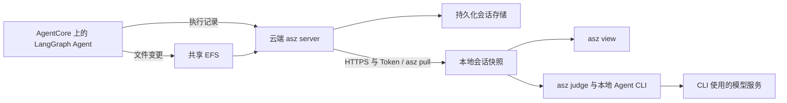

# 采集云端会话，本地评估：用 Apache SkyWalking AI Sessionizer 分析 Amazon Bedrock AgentCore 上的 AI Agent

> 编辑状态：中文初稿，2026-10-28。真实 Nova Pro 七轮会话、本地采集、HTTPS pull 和本地 Claude Code judge 已运行，见[本地实测记录](LOCAL-RESULTS.md)。AgentCore 部署与云端负载测量尚未完成；以下云端流程仍待验证。所有“待实测”标记必须在发布前替换，中英文使用同一批证据。

Agent 返回“已经完成”时，任务是否真的完成了？工具调用成功，可能只说明申请已经提交；配置文件写入成功，也不代表它通过了验证。另一些任务确实完成了，但中途反复修改，原因可能是 Agent 犯错，也可能是用户改变了要求。

在[此前的 AgentCore 实践](https://builder.aws.com/content/3KjX67DohBgEr8yPadw5MoDSV5C/agentcore-langgraph-agent)中，我们使用 Apache SkyWalking AI Sessionizer（命令名为 `asz`）保存 Agent 的执行记录和文件变更。这篇文章继续探索记录保存之后的工作：把选定的云端会话拉回开发者电脑，使用本地 Agent CLI 评估目标完成情况、执行成本及返工原因。

## 一个模拟发布助手，使用真实 Bedrock 模型

本次示例计划在 Amazon Bedrock AgentCore Runtime 上运行一个 LangGraph 发布助手。它调用真实的 Amazon Bedrock 模型，由模型选择工具、读取工具结果，并决定下一步操作。

模拟的是业务环境。配置验证工具读取实际生成的配置文件；部署工具将版本和配置摘要写入演示环境的状态文件；状态工具读取此前保存的结果。production 环境的部署权限被设置为拒绝，外部验收结果被设置为暂时不可查询。这些是公开的实验条件。

这种设置让我们能够观察 Agent 在成功、失败和证据不足时如何行动。它不会预先规定 Agent 的回答，也不会为 judge 写好结论。

【待实测：填入 AWS 区域、Agent 模型 ID、Agent 与 asz 提交号、镜像摘要、依赖版本和实验日期。】

## 云端采集与本地评估各自承担什么

Agent 通过 LangChain 的追踪客户端向云端 asz 发送执行记录。工具产生的文件变更通过共享目录交给 asz。云端服务组装并保存会话，同时为本地客户端提供远程拉取接口。



评估按需执行。日常采集不会自动启动 judge，云端采集服务也不需要安装评估 CLI 或维护它的登录状态。拉取完成后，本地可以针对这份快照多次评估。

这里的“本地评估”指评估进程、会话快照和结果保存在开发者电脑上。CLI 读取的会话内容仍会发送给它使用的模型服务。

【待实测：用最终部署图替换上图；写明 HTTPS 终止位置、Token 配置、本地连接方式及 ALB 健康检查方案。】

## 让一次发布经历多轮交互

我们将整个实验设计为同一段会话。每次调用携带相同的 AgentCore session ID，并将其用于 LangGraph 的 thread ID。

| 阶段 | 用户要求 | 实验提供的条件 |
| --- | --- | --- |
| 准备 | 生成 staging 配置，设置两个副本和 300 秒空闲超时，验证配置 | 配置可正常写入和检查 |
| 调整 | 用户将超时改为 600 秒，要求重新验证 | 保留修改前后的文件证据 |
| 部署 | 部署 staging 并查询状态，核对配置是否生效 | 模拟部署保存可读取的状态 |
| 推进 | 生成 production 发布包并部署 | 发布包可生成，production 部署明确被拒绝 |
| 验收 | 提交 staging 验收并确认是否通过 | 提交保存申请 ID，结果查询不可用 |
| 规划 | 提出自动扩缩容目标，要求先规划，等待确认再实施 | 尚未授权实施 |
| 收尾 | 取消自动扩缩容实施目标，汇总已有结果 | 取消与失败需要分别处理 |

这些条件不保证 judge 会生成某个固定的 target 划分。例如“生成发布包并部署”可以被识别为一个部分完成的目标，也可以被拆成一个完成目标和一个失败目标。我们需要检查结论是否与证据一致。

【待实测：补入实际会话片段；记录 Agent 是否遵循要求，不能将上表当作实际执行结果。】

## 拉取一个确定版本的会话

本地 asz 配置一个命名为 `demo` 的远程服务。下面的地址仅为占位示例，Token 文件由实际部署流程提供。

```yaml
storage:
  root: ./data
remotes:
  - name: demo
    url: https://asz.example.internal:8788
    token_file: ./secrets/demo.token
```

如果服务端使用私有 CA，还需要配置 `ca_file`。采集端使用的凭证与 pull Token 分开配置。

在该配置所在目录运行：

```sh
asz pull -list -remote demo
asz pull demo/CONVERSATION_ID
asz view
```

`CONVERSATION_ID` 替换为列表实际显示的标识。pull 返回的快照标签需要保存下来。快照固定了本次拉取的会话版本，后续云端交互不会修改它。

本次计划在准备配置之后、验收请求之后以及取消目标之后分别拉取一次，保存三个标签。它们属于同一段持续增长的 conversation。

【待实测：列举与 pull 的实际输出，以及本地页面中的远程会话和文件变更截图。】

## 使用本地 CLI 执行 judge

以已安装并登录的 Claude Code CLI 为例，对一个固定快照执行评估：

```sh
asz judge -evaluator claude -remote-conversation demo/CONVERSATION_ID:SNAPSHOT_TAG
asz judge -list -remote-conversation demo/CONVERSATION_ID:SNAPSHOT_TAG
asz judge -show RUN_NUMBER -remote-conversation demo/CONVERSATION_ID:SNAPSHOT_TAG
```

将占位符替换为实际会话标识、快照标签和运行编号。需要先拉取最新版本再评估时，可以使用：

```sh
asz judge -pull -evaluator claude -remote-conversation demo/CONVERSATION_ID
```

judge 通过只读的会话导航向 evaluator 提供记录。模型识别用户目标，判断完成情况，并标注工作类型；asz 根据已记录的模型用量和价格配置计算、分摊与汇总成本。没有记录的用量或没有配置的价格，应保留为未知或未定价。

## 报告中需要区分的五种情况

### 有证据支持完成

staging 部署的依据应包括写出的配置、验证结果、部署返回值和状态核对。报告中的 `achieved` 需要能够沿引用回到这些记录。

【待实测：实际 target、判定依据、引用和报告截图。】

### 完成了，但发生过返工

用户将 300 秒改为 600 秒，会触发修改和重新验证。judge 可以保留返工过程，并识别这是需求变化。返工不是独立的最终分类，也不自动降低完成评分；其成本和效率需要另外阅读。

如果模型实际犯错并被验证工具发现，再展示错误引起的返工。不能把用户改变需求的成本都算成 Agent 的可避免工作。

【待实测：实际 rework、原因、成本，以及该目标最终是否完成。】

### 明确失败与部分完成

production 发布包生成成功，与部署权限被拒绝是两个事实。报告需要保留已完成的工作，也不能把被拒绝的部署写成成功。

【待实测：实际目标划分，`not_achieved` 或 `partly` 等结论及其证据。】

### 无法验证

验收申请 ID 可以证明请求已被接受，却不能证明验收通过。当查询没有提供结果时，批准结果仍然未知。报告可能将提交与批准拆成两个目标，也可能在一个目标中分别列出已满足和无法确认的条件。

【待实测：未知条件和 `cannot_verify` 是否出现；如未出现，解释实际报告，不能替换或编造输出。】

### 用户取消的目标

用户取消自动扩缩容实施后，报告应将它与执行失败区分。已交付的计划与被取消的实施也可能是不同的目标。取消目标不计入完成评分。

【待实测：取消事件、目标状态与评分处理。】

## 生产侧增加了多少工作

首次拉取需要服务端准备并传输数据。重复拉取可以复用本地已有文件，但它仍需要与远程服务交互。只有对已经拉取的快照执行不带 `-pull` 的 judge，才不需要访问远程 asz。

我们计划分别记录日常采集、首次 pull、重复 pull 和本地 judge 期间的云端 CPU、内存、存储与网络活动，并在限制本机访问远程 asz 的情况下复验本地 judge。模型服务连接仍需可用。

【待实测：部署规格、会话规模、测量方法、样本次数和结果表。不能将小规模 PoC 外推为生产吞吐量保证。】

## 复现与继续使用

新示例计划放在原仓库的 `examples/pull-judge/`，使用独立镜像、配置和部署状态；上一篇文章的示例、命令和版本固定值保持原样。

【发布前补齐：新示例的固定提交链接、部署和清理命令、实测费用，以及所需模型访问条件。】

本地快照与其中的 judge 结果有保留期限。需要长期保留文章证据时，应另行归档完整实验材料。默认期限和配置方法以本次实际使用版本的文档为准。

## 参考资料

- [原示例仓库](https://github.com/wu-sheng/aws-agentcore-asz-demo)
- [Pull 使用指南（写作参考提交）](https://github.com/apache/skywalking-ai-sessionizer/blob/4ff3d426780d28ef06bced7050d60426e9cebbff/docs/en/setup/remote-pull.md)
- [Judge 使用指南（写作参考提交）](https://github.com/apache/skywalking-ai-sessionizer/blob/4ff3d426780d28ef06bced7050d60426e9cebbff/docs/en/setup/judge.md)
- [Judge 的判定与成本模型](https://github.com/apache/skywalking-ai-sessionizer/blob/4ff3d426780d28ef06bced7050d60426e9cebbff/docs/en/concepts-and-designs/conversation-judge.md)
- [AgentCore VPC 连接](https://docs.aws.amazon.com/bedrock-agentcore/latest/devguide/agentcore-vpc.html)
